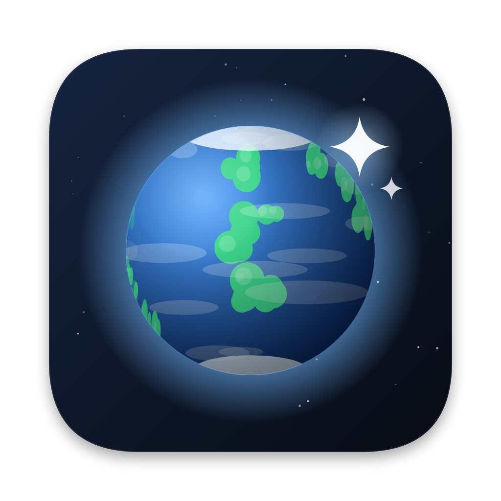
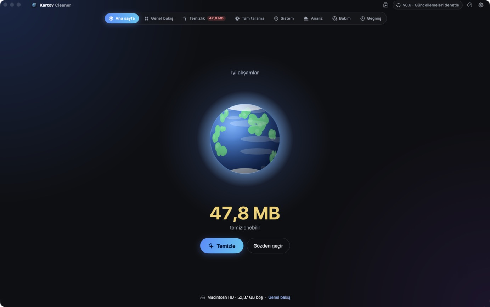
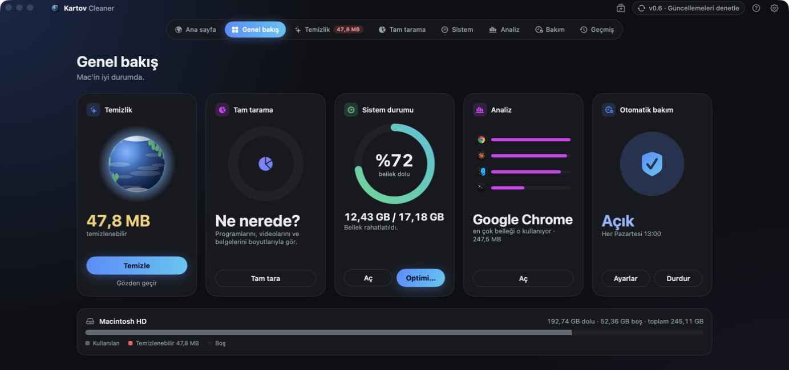
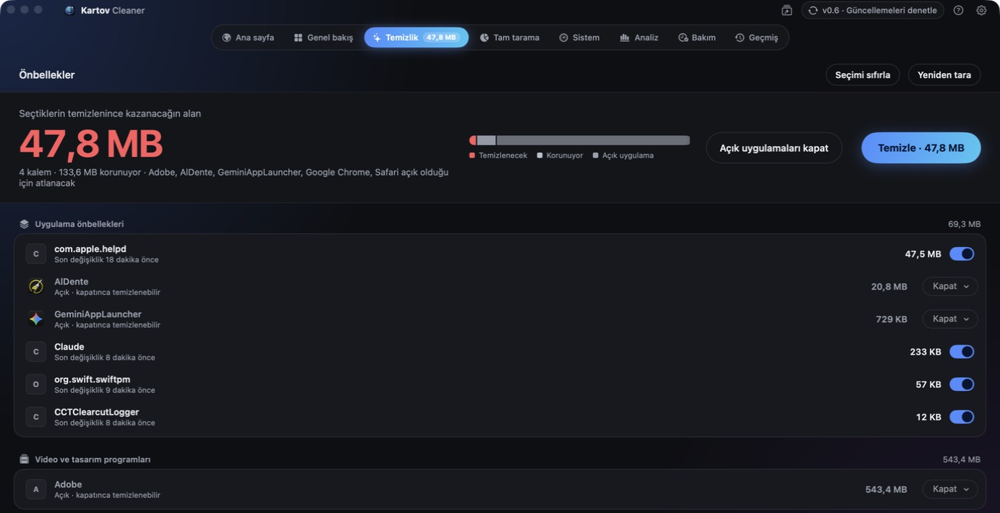
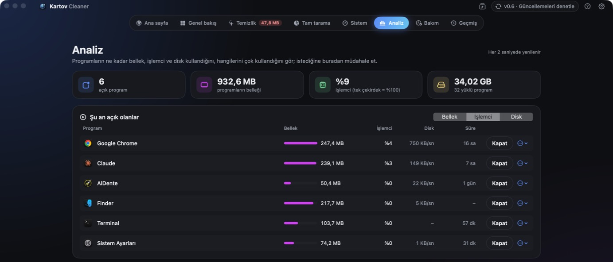
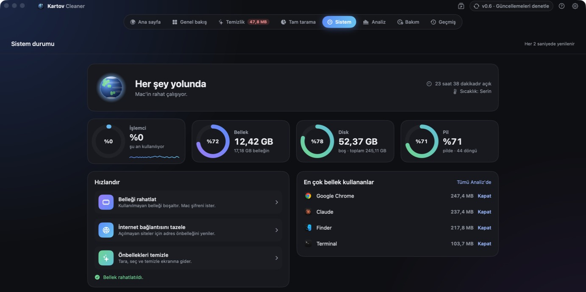
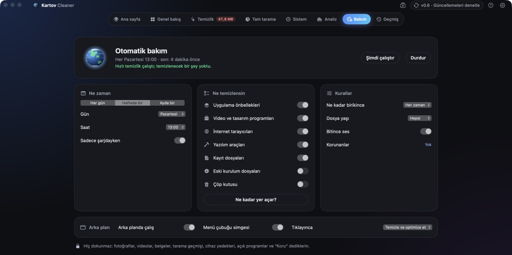

<p align="center">
  
</p>

<h1 align="center">Kartov Cleaner</h1>

<p align="center">
  A clean, safe and transparent cleaner for your Mac.<br>
  <sub>Available in English · Türkçe · Deutsch · Español</sub>
</p>

<p align="center">
  <a href="../../releases/latest"><b>⬇︎ Download the latest version</b></a>
</p>

<p align="center">
  
</p>

---

## What it does

🌍 **Your world mirrors your Mac.** As caches and junk pile up, the globe on the home screen gets dirty. Clean up and it turns blue again.

- **Cleanup:** Removes caches from apps, browsers, creative tools (After Effects, Premiere, DaVinci Resolve) and developer tools, plus old logs, leftover macOS installers and System Data. You choose **Clean** or **Keep** for each app and see how much space you'll get back before anything happens.
- **Projects (new in 0.8):** Finds your After Effects and Premiere Pro projects and shows what piled up next to each one: preview renders, media caches, auto-saves, proxies and Media Encoder leftovers. Projects you haven't saved in 30 to 180 days are flagged, and one click selects only the caches that rebuild themselves. Project files, media and renders are never offered; everything goes to the Trash. External disks can be added.
- **Full scan:** Lists your apps, videos, images and documents by size. Sort them, multi-select, and move what you don't need to the Trash.
- **Analysis:** Shows which apps are open and how much memory, CPU and disk each one uses, which ones you use most, and which you haven't opened in months. You can quit, force quit or uninstall them.
- **System status:** Live CPU, memory, disk and battery. Free up memory in one click and trim the apps that start at login.
- **Auto maintenance:** Cleans the categories you pick, on the day and time you choose. It never touches your personal files.
- **Menu bar:** One click on the little globe cleans, optimizes, or does both.
- **Updates:** Lets you know when a new version is out and installs it only if you say so.

### Guardian (new in 0.7)

Kartov now keeps an eye on your Mac in the background, once a minute. It only reads; it never deletes anything.

- **Alerts:** an app straining the processor for minutes, memory pressure, a disk that is almost full or filling fast, and apps whose files suddenly grow. Work profiles keep it quiet while you render, compile or play.
- **Disk forecast:** estimates when your disk will be full at the current pace.
- **Early warning and weekly summary (0.8):** a heads-up when the disk is on track to fill within two weeks, and one notification each Monday with how the disk moved, what was cleaned, alerts, crashes and untouched projects.
- **Energy:** live per-app power and what drained the battery over the last 24 hours.
- **Crashes:** 30 days of crash, hang and unexpected-restart reports, explained in plain words.
- **Privacy:** which apps can use your camera, microphone, screen, files, contacts and more, with apps you no longer use or have removed listed first.
- **Living globe:** the home globe warms up under CPU load, clouds over under memory pressure, and a ring shows how full the disk is.
- **Related files:** a map of everything an app keeps in your Library (cache, logs, settings, support files, startup items). Only regenerable files can go to the Trash, after you confirm.
- **Cleanup passport:** a running total of everything you've cleaned, by section and month, with a copyable report for each cleanup.

## Screenshots

| Overview | Cleanup |
|:---:|:---:|
|  |  |
| **Analysis** | **System status** |
|  |  |

<p align="center">
  <br>
  <sub>Auto maintenance · screenshots show the Turkish interface; the app follows your Mac's language (English, Türkçe, Deutsch, Español).</sub>
</p>

## Safety first

- Scanning **never deletes anything**; it only looks.
- Caches are deleted, and apps rebuild them when needed. Personal files, uninstalled apps and installers go to the **Trash**, and **History › Undo** brings them back in one click.
- You are **always asked** before browsing history is cleared or the Trash is emptied.
- Caches of apps that are currently open are never touched.
- The Photos library, iCloud Drive, Mail, Keychain and the inside of app bundles are off-limits in code.
- Kartov **never sends your data anywhere.** Its only network request checks GitHub for new versions.

## Install

1. Download `Kartov Cleaner x.x.dmg` from [Releases](../../releases/latest).
2. Open the DMG and drag **Kartov Cleaner** into **Applications**.
3. A short intro tour starts on first launch. Its last step asks for **Full Disk Access** (System Settings › Privacy & Security › Full Disk Access › turn on Kartov Cleaner). The app works without it, but some folders can't be scanned.

> **Seeing a "cannot be verified" warning?** Right-click the app and choose **Open**, or go to System Settings › Privacy & Security and click **Open Anyway**. The warning will go away once the app is signed with an Apple Developer ID.

**Requirements:** macOS 13 Ventura or later · Apple silicon and Intel

## Build from source

```bash
git clone https://github.com/Rhinry/kartov-cleaner.git
cd kartov-cleaner
bash install.sh    # builds, installs to ~/Applications and opens it
bash build-dmg.sh  # optional: builds a DMG into the dist/ folder
```

Xcode or the Command Line Tools (`xcode-select --install`) are all you need.

## Contributing

Bug reports, ideas and pull requests are welcome. New cleaning locations live in [`Sources/KartovCore/Resources/rules.json`](Sources/KartovCore/Resources/rules.json); translations live in [`strings.json`](Sources/KartovCore/Resources/strings.json).

## License

[MIT](LICENSE) © 2026 Umut Kartov

---

<p align="center"><sub>Designed by Umut Kartov</sub></p>
